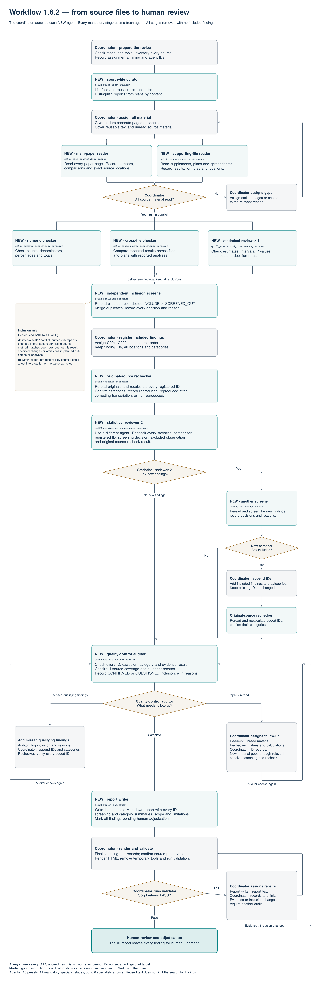

# TRACE-Q

TRACE-Q is an exploratory multi-agent toolkit for quantitative reporting review.
It maps supplied trial reports and supporting documents, checks quantitative
relationships, screens and rechecks candidate concerns, and organizes evidence
for human assessment.

This repository contains Workflow 1.6.2, original source documents, and selected
AI-stage records for 44 JAMA trial packages. The original records register 440 candidates. These counts
describe automated review outputs; they are not counts of human-confirmed issues.
Four completed R_Bulun adjudication workbooks are included separately; the
AI reports retain their historical content and have not been regenerated from those decisions.

## Workflow

Select the image to view the full-resolution English flowchart.

## Contents

| Path | Contents |
|---|---|
| [toolkit/](toolkit/README.md) | One complete, unchanged copy of Workflow 1.6.2, including its project `.codex/` configuration, ten agent presets, rules, and supporting scripts. |
| [results/index.csv](results/index.csv) | Index of the 44 packages, reports, candidate counts, article DOI links, and original validation statuses. |
| [results/](results/README.md) | Original paper/protocol/SAP/supplement files, final Markdown/HTML reports, canonical review records, and selected linked evidence records. |
| [human_adjudication/](human_adjudication/README.md) | Four completed v2.4.1 R_Bulun workbooks for 2018, 2019, 2024, and 2025. |
| [results/source_files.csv](results/source_files.csv) | Original input filenames and SHA-256 hashes for the bundled 188 PDFs and one supplementary workbook. |
| [DATA_AVAILABILITY.md](DATA_AVAILABILITY.md) | Included materials, omitted inputs, and the limits of this curated copy. |
| [COPY_NOTES.md](COPY_NOTES.md) | Selection rules, provenance, and copy-validation scope. |
| [migration_manifest.csv](migration_manifest.csv) | Source-relative paths, destination paths, sizes, and SHA-256 hashes for all copied files. |
| [copy_validation.json](copy_validation.json) | Mechanical integrity and structure checks of this copy. |
| [results/html_navigation_fixes.csv](results/html_navigation_fixes.csv) | Navigation-only anchor additions in five HTML copies; report text and source originals are unchanged. |

## Use the toolkit

Start with [USAGE.md](toolkit/USAGE.md) and
[CODEX_SETUP.md](toolkit/CODEX_SETUP.md). Put the contents of `toolkit/`, including
`.codex/`, into a separate working package containing the documents to review.
Preserve unrelated package instructions and configuration when merging files.
Follow the supplied workflow instructions from that individual package root.
The repository root and `results/` are not new paper-review workspaces.

The supplied project configuration fixes the run model and agent roles; it does
not contain personal provider credentials. The default model recorded in this
version is `gpt-6.1-sol`. Consult the setup instructions for model selection and
the local tools used for extraction and report generation.

Reusable extraction assets are optional under the workflow's operative
instructions: `toolkit/AGENTS.md` explicitly handles `NO_REUSABLE_ASSETS` and
requires fresh inspection of uncovered units. The unchanged `USAGE.md` step 2
describes the reuse-oriented starting case. A new package still needs its actual
source documents; this repository's historical reports are not a source for fresh
candidate discovery.

## Read the application records

Download the repository with its folder structure intact, then open a package's
`final_report_1_6_2.html` in a local browser. HTML styling is embedded. Original
inputs retain their filenames and package-relative locations, so report links
resolve to the bundled paper, protocol, SAP, and supplementary files. The exact
evidence records directly linked by the HTML reports are also included. PDF page
fragments retain the original `#page=N` locations; opening the XLSX supplement
depends on the browser's file-handling settings and spreadsheet software.

All 44 final HTML reports have been checked for local file targets. Some secondary
Markdown records refer to omitted caches or subsequent review materials; those
references are listed in [results/omitted_links.csv](results/omitted_links.csv).
See [results/README.md](results/README.md) for the scope of the link checks.

The original `review_validation.json` files record checks of the original full
packages. Their `PASS` statuses do not validate this reduced distribution or
establish scientific correctness. No new scientific review or model run was
performed during copying. The completed workbooks are supplied alongside the
historical AI reports. Manuscript sources and statistical analysis scripts remain
outside this repository, so workbook inclusion alone is not a complete
reproduction of the manuscript analyses.
